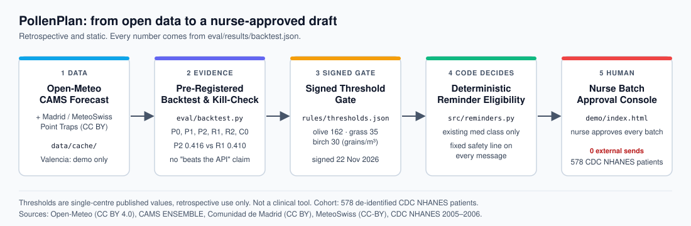

# PollenPlan - Static Backtest Demo (GitHub Pages)

A minimal static demo for GitHub Pages visualizing the pre-registered backtest results for the PollenPlan alert system.

## Important Disclaimers

- **Retrospective analysis only** - Results are from historical data and do not predict future performance
- **Not a clinical tool** - This demo does NOT provide medical advice or clinical guidance
- **No "beats the API" claim** - The backtest shows measured P2 skill without evidence it outperforms the API's own forecast
- **Thresholds signed 22 Nov 2026** - Alert thresholds in `rules/thresholds.json` (olive 162, grass 35, birch 30 grains/m³, daily mean) are status `signed` (CRITERIA_FOR_SIGNOFF rows 1–4 as proposed); retrospective use, not clinical guidance
- **Model vs reality** - CAMS is an 11 km grid model; ground truth comes from point traps. This mismatch affects accuracy.



## What's in This Repo

| Component | Description |
|-----------|-------------|
| `eval/backtest.py` | Pre-registered backtest script (DATA_PLAN 2.3) |
| `eval/results/backtest.json` | Full machine-readable backtest results |
| `eval/results/misses.csv` | Every missed observed high day |
| `docs/results_table.md` | Human-readable results table |
| `demo/index.html` | **This demo** - static visualization for GitHub Pages |
| `demo/index.html` (`#nurse-console`) | **Nurse Briefing & Batch Approval Console** - replays four scenarios (Valencia control: 0 drafted; Madrid grass, Basel birch, olive simulation) over 200 synthetic patients; shows drafts and code-filtered patients, and approval writes an in-page audit line. 0 external sends; nothing leaves the browser |
| `CLAIMS.md` | Every public number and feature claim with its source key and command |
| `JUDGES.md` | Guide for judges mapped to the four criteria, with honest limits and review backlog |
| `docs/flow.svg` | Workflow diagram (embedded above) |
| `eval/render_demo.py` | Writes the demo's onset table (all 28 seasons) from `backtest.json`; `--check` fails if the HTML is stale |
| `rules/thresholds.json` | Alert thresholds (signed 22 Nov 2026) |
| `tests/` | Unit tests for backtest rules and reminder logic |
| `src/reminders.py` | Reminder eligibility rules (signed 22 Nov 2026) |

## Quick Start

1. Run the backtest to generate results:
   ```bash
   make backtest
   ```

2. Open `demo/index.html` in a browser to see the static demo

3. For a local preview of the Pages site:
   ```bash
   python -m http.server 8000 -d demo
   open http://localhost:8000
   ```

## Setup

### Prerequisites

- Python 3.9+
- `requirements.txt` packages (see below)

### Install Dependencies

```bash
python -m venv .venv && .venv/bin/pip install -r requirements.txt
```

### Run the Full Pipeline

```bash
make all
```

This fetches data, creates synthetic patients, runs tests, and generates backtest results.

### Run Just the Backtest

```bash
make backtest
```

### Run Tests

```bash
make test
```

## Demo Deployment

### GitHub Pages Setup

Pages can publish from a branch only at `/` (root) or `/docs`, not `/demo`. This repo therefore deploys `demo/` with the workflow `.github/workflows/deploy-pages.yml` (`actions/upload-pages-artifact` + `actions/deploy-pages`).

1. Go to your repository's **Settings** > **Pages**
2. Under **Build and deployment** > **Source**, select **GitHub Actions**
3. Push to `main` (or run the `deploy-pages` workflow manually from the **Actions** tab)

Your demo will be available at `https://<username>.github.io/<repo>/`

### Custom Domain (Optional)

Set the custom domain under **Settings** > **Pages** > **Custom domain**, then configure DNS. With an Actions deployment, a `CNAME` file in `demo/` is not used.

## Methodology

### Alert Rules Evaluated

| ID | Rule | Description |
|----|------|-------------|
| P0 | Observed(D-1) ≥ T | Persistence baseline |
| P1 | API(D-1) ≥ T | API persistence |
| **P2** | **API(D) ≥ T** | **API's own forecast (kill-check baseline)** |
| R1 | mean(API(D-1), API(D)) ≥ T | Two-day exposure (PollenPlan day rule) |
| R2 | First in-season day where max(API(D..D+3)) ≥ T | Pre-peak alert |
| C0 | Climatology: prior year share of high days ≥ 0.5 | Calendar-only reminder |

### Cities Scored

| City | Species | Source |
|------|---------|--------|
| Madrid | olive, grass | Comunidad de Madrid (FACF) |
| Basel | birch, grass | MeteoSwiss (PBS) |
| Zurich | birch, grass | MeteoSwiss (PZH) |

**Valencia** (the app's target city) has no observed ground truth in this repo, is **never scored**, and is excluded from all evaluation; the Clínica Demo console uses a Valencia 2025 CAMS control replay (labelled model output only, never scored).

### Season Definition

Season windows are derived from training years (2021-2023) only:
- First/last day with ≥1 grain/m³ observed pollen
- Clipped to named months (olive Apr-Jun, grass Mar-Jul, birch Mar-Apr)
- 7-day centred rolling mean applied to training-year averages

### Kill-Check (DATA_PLAN 2.5)

1. Observed counts exist for ≥3 cities over ≥1 year
2. **"Alert == the API's own forecast"**: R1 and R2 must beat P2
   - R1 vs P2: recall at equal-or-fewer false-alert days
   - R2 vs P2: mean lead days with bootstrap CI excluding zero
   - R2 vs C0: mean lead days with bootstrap CI excluding zero
3. If P2 recall <50% in Madrid for both species, alert level only lowered with re-sign-off
4. Valencia never scored

**Current verdict**: R1 did not beat P2 on pooled recall → **no "beats the API" claim allowed**

## Results Summary

### Overall Headline

```
measured_P2_skill_only_no_beats_api_claim
```

### Key Metrics

| Metric | Value |
|--------|-------|
| Total events (P2 denominator) | 863 |
| Evaluated city-days | 8076 |
| Pooled P2 recall | 0.416 |
| Pooled R1 recall | 0.410 |
| Madrid olive P2 recall | 0.136 |
| Madrid grass P2 recall | 0.314 |
| R2 vs P2 lead days | +2.88 days (95% CI [+2.64, +3.00]) |
| R2 vs P2 timing | R2 uses API values for D..D+3: fires up to 3 days before P2 by construction, never after (look-ahead, not extra skill; archived D+1..D+3 may beat a live forecast) |
| R2 vs C0 lead days | -1.55 days (95% CI [-7.75, +6.00]) |
| R2 beats C0 (lead days CI excludes zero) | No |

### Madrid Performance

| Species | P2 Recall |
|---------|-----------|
| Olive | 13.6% (below 50% threshold) |
| Grass | 31.4% (below 50% threshold) |

Both Madrid species have P2 recall below 50% → **limits** number per kill-check check3.

## Limits & Known Issues

1. **Trap-versus-grid mismatch**: Point measurements vs 11 km grid model
2. **Open-Meteo has no pollen category**: No stated validation; docs call it a forecast, not measurement
3. **Thresholds from single-centre studies**: The newest large panel found no consensus thresholds (T5, DATA_PLAN 2.6)
4. **Only 5 seasons**: Limited statistical power; intervals will be wide
5. **Pre-Oct-2023 API source unverified**: See DATA_PLAN section 2.1
6. **Measures alert quality only**: No data on reduced symptoms, visits, or patient outcomes
7. **Madrid P2 recall below 50%**: Both olive (13.6%) and grass (31.4%) fail this threshold

## Data Attribution

- **Modelled pollen**: Open-Meteo Air Quality API (licence CC BY 4.0; free tier for non-commercial use). Required attribution: [Weather data by Open-Meteo.com](https://open-meteo.com/) and "CAMS European air quality forecasts, ENSEMBLE data".
- **Observed Madrid**: Comunidad de Madrid, Histórico de mediciones de polen (Creative Commons Attribution, CC BY)
- **Observed Basel/Zurich**: Source: MeteoSwiss (CC-BY)
- **Synthetic patients**: Seeded generator (20261120)

## License

[See LICENSE file](LICENSE) for repository license.

---

**This demo is static, retrospective, and limited. Not for medical use.**
